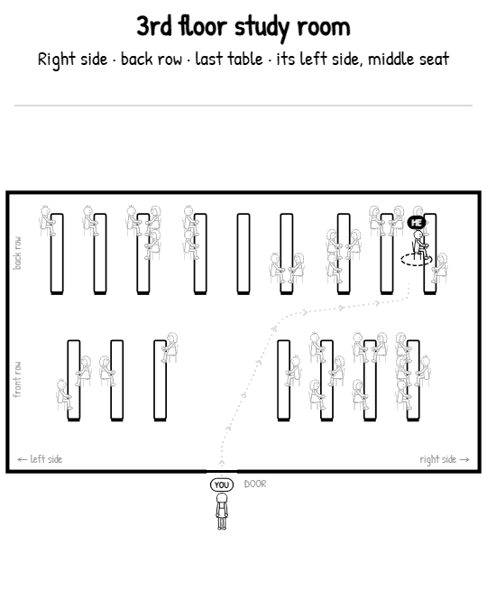

# Find me in the study room

Pick your seat on a map of the study room. You get a short black & white animation, as a portrait
GIF made for WhatsApp, showing your friend walking in through the door and finding you. The camera
opens on the whole room, follows your friend, and pulls back at the end to show the full route.



## Run locally

```
npm start        # http://localhost:5173
```

No build step: plain HTML + ES modules, so it can be deployed as a static site (e.g. Vercel).

## How it works

- `js/rooms.js` – room config (front row split by the door, back row, groups of tables) → table/seat geometry and the written directions.
- `js/path.js` – A* route around tables and seated students, string-pulled, rounded corners, and a speed profile that eases in/out and slows through bends.
- `js/character.js` – style #9 characters drawn from a small skeleton. Feet follow planted/swing paths with IK knees, so they don't slide.
- `js/scene.js` – the story timeline and a shot-based camera (holds, short pans, zoom-out outro). `renderFrame(ctx, t)` is a pure function of time, so the preview and the GIF match frame for frame.
- `js/gif.js` – in-browser GIF export: 540×675 portrait, 8 greys, unchanged pixels encoded as transparent, so a GIF is ~1–1.5 MB.
- Sharing: on a phone (HTTPS or localhost) "Share to WhatsApp" uses the Web Share API; otherwise download and send the file.

Room layouts are edited in the app under "Set up rooms" (saved in your browser; "Copy JSON" to bake them into `DEFAULT_ROOMS`).
The URL hash encodes room + seat, so a link reproduces the same animation.

## Character concepts

`characters/` holds the Gemini concept sheets used to pick the art style (`scripts/gen_characters.py`).
The script reads `GEMINI_API_KEY` from `.env`, which is git-ignored — never commit a key.
